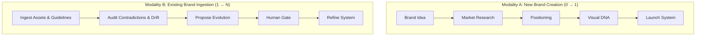
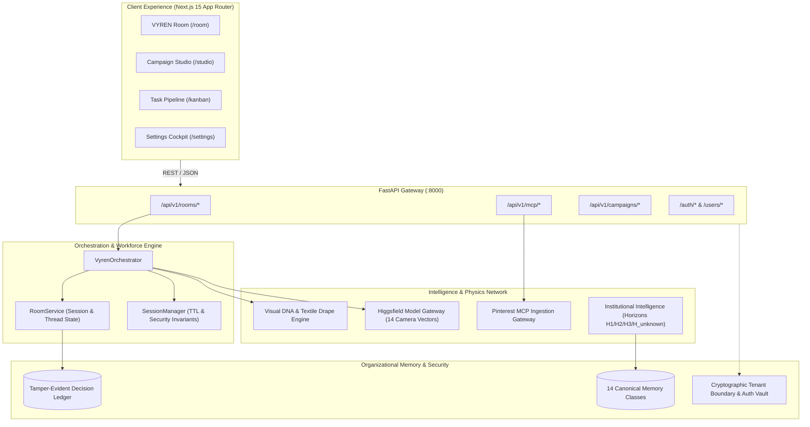

<p align="center">
  
</p>

<h1 align="center">❖ VYREN</h1>

<p align="center">
  <strong>AI-Powered Brand Intelligence & Creative Operating System</strong><br />
  <em>An Institutional Platform by ILYREN</em>
</p>

<p align="center">
  <a href="#system-architecture"></a>
  <a href="#test-verification"></a>
  <a href="#tech-stack"></a>
  <a href="#tech-stack"></a>
  <a href="#tech-stack"></a>
  <a href="#governance-invariants"></a>
</p>

---

### Executive Thesis

> **"Every brand deserves an intelligent creative organization that remembers what it knows, understands why it makes decisions, learns from what happens, and continuously helps it become more distinctive."**

VYREN is not a single prompt sandbox, an ephemeral chatbot, or a generic image generator. It is a persistent **Brand Intelligence & Creative Operating System** built for founders, creative directors, and brand operators. It unites deep market research, optical lighting and textile physics, persistent AI coworkers, and cryptographic decision ledgers into a continuous, self-improving operating loop.

---

### Key Architectural Pillars

| Continuous Operating Loop | Dual Brand Modalities | Governed Authority |
| :--- | :--- | :--- |
| **CREATE → DECIDE → DESIGN → LAUNCH → LEARN → EVOLVE**.<br />Decisions, creative hypotheses, and market outcomes feed continuous organizational memory. | Supports **Modality A** ($0 \to 1$ New Brand Creation) and **Modality B** ($1 \to N$ Existing Brand Ingestion, Drift Auditing & Evolution). | **Intelligence ≠ Authorization**.<br />AI coworkers reason, research, and execute approved tasks; consequential decisions require explicit human sign-off. |

---

## 1. The Industry Problem

Modern generative tooling treats brand design as an isolated, amnesiac series of prompts:

* **No Memory or Continuity:** Chatbots forget brand decisions across sessions; each campaign begins from scratch.
* **Ungrounded Visual Drift:** Diffusion tools hallucinate inconsistent lighting, fabric drape, and silhouettes, violating core brand identities.
* **Tool & Data Fragmentation:** Research sits in slide decks, assets in cloud drives, prompts in notebooks, and ad performance in separate silos.
* **Unaccountable AI Execution:** Autonomous tools risk self-authorizing budget, launching unreviewed creative, or polluting corporate memory with hallucinations.

---

## 2. The Solution: VYREN Operating Loop

VYREN acts as an intelligent creative organization that partners with human leadership through a governed 6-stage lifecycle:

```text
 ┌────────────────────────────────────────────────────────────────────────┐
 │                        THE VYREN OPERATING LOOP                        │
 └────────────────────────────────────────────────────────────────────────┘
     CREATE       ► Formulate new brand identities, positioning, and campaigns.
       │
     DECIDE       ► Evidence-backed recommendation memos and trade-off matrices.
       │
     DESIGN       ► Synthesize Visual DNA, 3D textile drape physics, and lighting.
       │
     LAUNCH       ► Deploy omnichannel multi-surface creative variations.
       │
     LEARN        ► Ingest live market signals, attribution, and audience response.
       │
     EVOLVE       ► Update organizational memory so future campaigns grow smarter.
       │
     └────────────► Loops back to CREATE with enriched contextual memory.
```

### The Dual Brand Modalities



---

## 3. Product Experience & The VYREN Room

The primary interaction layer of VYREN is the **VYREN Room** (`/room`) — a persistent collaborative studio where human creative directors work alongside scoped AI personas:

* **Live Operational Trace:** Real-time visibility into the agent runtime dispatch, tool usage, and research queries.
* **Inline Interactive Artifacts:** Visual DNA cards, textile physics evidence, audience lift reports, and moodboards rendered directly in the thread.
* **Human Decision Gates:** Consequential pivot points (e.g. locking a primary creative direction) are presented as interactive gates. No downstream production assets are synthesized without human authorization.
* **Pinterest & External MCP Ingestion:** One-click ingestion of curated visual boards with automated extraction of color weights, lighting temperatures ($2800\text{K}$ Tungsten vs $6500\text{K}$ Cyan Rim), and fabric stiffness tokens.

---

## 4. System Topology & Architecture

VYREN is engineered as a multi-tier, tenant-isolated architecture across backend micro-engines and modern frontend surfaces:



---

## 5. Persistent AI Workforce Roster

VYREN organizes work across specialized, persistent AI personas with strictly bounded roles:

| Persona | Role | Authority Boundary | Primary Responsibilities |
| :--- | :--- | :--- | :--- |
| **VYREN** | Creative Operating System | Core Dispatcher | Synthesizes turn context, enforces governance invariants, routes tasks, records artifacts. |
| **Marcus Vance** | AI Creative Director | Advisory & Synthesis | Generates visual territories, establishes lighting setups, calibrates camera trajectories. |
| **Siddharth Rao** | Intelligence Specialist | Advisory / Research | Analyzes audience lift signals, audits competitive landscape, evaluates market trends. |
| **Elena Vance** | Human Creative Director | **Ultimate Authority** | Authorizes strategic commitments, commits decision gates, triggers asset publication. |

---

## 6. Core Subsystems

### A. Creative Intelligence & Textile Drape Physics
* **Material Shaders:** Physically-based tokens for textiles (e.g. Banarasi raw silk stiffness factor $0.84$, micro-crease distribution, gold zari metallic specular reflection).
* **Optical Lighting Configs:** Exact Kelvin temperature parameters ($2800\text{K}$ Tungsten Key, $6500\text{K}$ Cyan Rim) to eliminate optical glare on metallic embroidery.

### B. Visual Model Gateway (Higgsfield Engine)
* **Unified Creative Engine:** High-resolution text-to-image and cinematic image-to-video synthesis.
* **14 Camera Trajectories:** Standardized camera motion vectors including 360° digital turntables, dolly, crane, roll, pan, and orbital sweeps.
* **Waterfall Failover:** Deterministic fallback routing: Higgsfield $\longrightarrow$ Gemini 2.5 Flash $\longrightarrow$ Deterministic Sandbox.

### C. Institutional Intelligence & Memory
* **Strategic Horizons:** Governed planning across $H_1$ (current quarter execution), $H_2$ (medium horizon brand evolution), $H_3$ (long-term distinctiveness), and $H_{\text{unknown}}$ (emergent market shifts).
* **14 Canonical Memory Classes:** Strictly typed records preserving hypotheses, observations, decisions, contradictions, counterfactuals, and learning signals.

---

## 7. Governance Invariants & Security

VYREN enforces fail-closed architectural invariants to prevent AI hallucination from mutating institutional policy:

> [!IMPORTANT]
> ### The 8 Core Governance Axioms
> 1. **Intelligence ≠ Authorization:** High-confidence recommendations do not constitute execution permission.
> 2. **Agent ≠ Authority:** AI personas cannot self-authorize budget, strategy, or policy mutations.
> 3. **Recommendation ≠ Decision:** Proposals remain inert until signed off by a human `DecisionRecord`.
> 4. **Fail Closed:** Any tenant mismatch, missing permission, or ambiguous boundary raises a hard block.
> 5. **Tenant Isolation:** Every room, session, and asset is cryptographically bound to a verified `tenant_id`.
> 6. **Tamper-Evident Memory:** The Decision Ledger uses cryptographic hash chaining to prevent retroactive record forgery.
> 7. **Zero-Secret Commits:** All credentials reside in `.env`; raw keys are barred from source files.
> 8. **Preserve Contradictions:** Contradictory evidence must survive in memory rather than being averaged out.

---

## 8. Prerequisites

| Software | Minimum Version | Required / Optional | Download / Sign-up Link |
| :--- | :--- | :--- | :--- |
| **Python** | `3.12+` | **Required** | [python.org/downloads](https://www.python.org/downloads/) |
| **uv** | `latest` | **Required** | [docs.astral.sh/uv](https://docs.astral.sh/uv/) |
| **Node.js** | `18.18+` / `20+` | **Required** | [nodejs.org](https://nodejs.org/) |
| **npm** | `9+` | **Required** | Included with Node.js |
| **MongoDB** | `6.0+` (or Atlas) | Optional (Local mock fallback active) | [mongodb.com/try/download/community](https://www.mongodb.com/try/download/community) |
| **Redis** | `7.0+` | Optional (In-memory fallback active) | [redis.io](https://redis.io/) |

---

## 9. Quick Start Guide

### Path A: One-Click Startup (Windows)

VYREN includes an automated startup script that verifies virtual environments, installs missing packages, cleans up previous ports, and boots both servers simultaneously:

```bat
.\start-app.bat
```

> [!NOTE]
> The startup script performs clean port termination on `:3000` and `:8000`, verifies the Python virtual environment via `uv`, validates frontend dependencies, checks backend health, and launches the application in parallel terminals.

---

### Path B: Manual Local Setup

#### 1. Clone & Configure Backend
```bash
# Navigate to backend directory
cd Visual-Intelligence/product/backend

# Create virtual environment with uv and Python 3.12
uv venv --python 3.12 .venv

# Activate virtual environment
# Windows:
.venv\Scripts\activate
# Unix/macOS:
# source .venv/bin/activate

# Install dependencies
uv pip install -r requirements.txt

# Start FastAPI server on port 8000
python -m uvicorn app.main:app --reload --host 127.0.0.1 --port 8000
```

#### 2. Configure & Start Frontend
```bash
# Open a new terminal and navigate to frontend directory
cd Visual-Intelligence/product/frontend

# Install dependencies
npm install

# Start Next.js development server on port 3000
npm run dev
```

#### Service Port Map
| Service | Environment | Port | URL |
| :--- | :--- | :--- | :--- |
| **VYREN Frontend** | Next.js 15 | `:3000` | `http://localhost:3000` |
| **VYREN Backend** | FastAPI / Uvicorn | `:8000` | `http://127.0.0.1:8000` |
| **API Documentation** | OpenAPI Swagger (dev) | `:8000` | `http://127.0.0.1:8000/docs` |
| **Health Check** | API Health Endpoint | `:8000` | `http://127.0.0.1:8000/health` |

---

## 10. Environment Variables Reference

Configure environment settings in `Visual-Intelligence/product/backend/.env`:

| Variable Name | Required | Default Value | Description |
| :--- | :---: | :--- | :--- |
| `ENVIRONMENT` | ❌ | `development` | Runtime environment (`development` or `production`). |
| `MONGODB_URI` | ❌ | `mongodb://localhost:27017` | MongoDB connection string (Atlas or local). |
| `MONGODB_DB_NAME` | ❌ | `atelier_os` | Target database name. |
| `REDIS_URL` | ❌ | `redis://localhost:6379` | Redis cache and session connection URL. |
| `SUPABASE_URL` | ❌ | `https://your-ref.supabase.co` | Supabase project URL for authentication. |
| `SUPABASE_ANON_KEY` | ❌ | `your-anon-key` | Supabase public anonymous API key. |
| `SUPABASE_JWT_SECRET`| ❌ | `your-jwt-secret` | JWT secret used to verify bearer tokens server-side. |
| `GEMINI_API_KEY` | ❌ | `""` | Google AI Studio API key for Gemini 2.5 Flash reasoning. |
| `OPENAI_API_KEY` | ❌ | `""` | OpenAI API key for agent runtime models. |
| `RAZORPAY_KEY_ID` | ❌ | `""` | Razorpay Key ID for domestic billing. |
| `RAZORPAY_KEY_SECRET`| ❌ | `""` | Razorpay Key Secret for signature verification. |

> [!CAUTION]
> Never commit `.env` or production API tokens into version control. Ensure all `.env` files match the rules in `.gitignore`.

---

## 11. Project Structure

```text
MERCER-VYREN/
├── assets/
│   ├── logo.png                     # Official VYREN brand emblem
│   └── reference_libraries/         # Ingested textile and fashion references
├── docs/
│   ├── PROJECT-TASK-TRACKER.md      # Verified progress and outstanding roadmap
│   ├── HIGGSFIELD-API-INTEGRATION.md # Higgsfield camera vectors specification
│   └── VYREN-AGENTIC-ROOM-*.md      # Room architecture directives
├── Visual-Intelligence/
│   ├── engine/                      # Core computational models and ontologies
│   └── product/
│       ├── backend/                 # FastAPI backend application
│       │   ├── app/
│       │   │   ├── config.py        # Pydantic v2 settings with safe defaults
│       │   │   ├── database.py      # MongoDB connection management
│       │   │   ├── main.py          # Application entry point (41 routes)
│       │   │   └── routers/         # Campaigns, generate, payments, users
│       │   ├── src/
│       │   │   ├── agent_runtime/   # MCP gateways, sessions, and OAuth vaults
│       │   │   ├── api/routes/      # vyren_room_routes and mcp_routes
│       │   │   ├── orchestrator/    # VyrenOrchestrator turn execution engine
│       │   │   └── vyren_room/      # RoomService and thread models
│       │   ├── tests/               # 110-test zero-regression validation suite
│       │   └── run_phase31_room_tests.py # Master test runner
│       └── frontend/                # Next.js 15 App Router application
│           ├── src/
│           │   ├── app/             # 23 dashboard routes (/room, /kanban, /settings)
│           │   ├── components/      # Bento boards, VyrenRoomView, RadialMenu
│           │   └── lib/             # Typed API clients (room.ts, api.ts)
│           └── next.config.ts       # Backend proxy rewrite rules
└── start-app.bat                    # One-click Windows development bootloader
```

---

## 12. Tech Stack

* **Backend & Systems:** Python 3.12, FastAPI, Pydantic v2, SlowAPI, OpenTelemetry, Uvicorn.
* **Frontend Engineering:** Next.js 15 (App Router), TypeScript 5.6, Tailwind CSS, Lucide Icons, Framer Motion.
* **Agent Runtime & Protocols:** Model Context Protocol (MCP), Pinterest API v5 Gateway, OAuth Vault.
* **Generative & Physics Gateway:** Higgsfield Unified Creative Engine, Google Gemini 2.5 Flash, 3D Textile Drape Solvers.
* **Databases & Cache:** MongoDB (Motor async driver), Redis (Connection caching).
* **Quality Assurance:** Pytest, pytest-asyncio, FastAPI TestClient.

---

## 13. Test Verification

VYREN maintains a strict zero-regression policy. Run the comprehensive test suite to verify all institutional intelligence, room orchestration, and security invariants:

```powershell
# From backend directory
python run_phase31_room_tests.py
```

### Verified Baseline
```text
======================================================================
[PASS] ALL TESTS PASSED: PHASE 31 & MCP (29 TESTS) + PHASE 30 (81 TESTS) = 110/110 (100%)
======================================================================
```

To run the frontend TypeScript verification:
```powershell
# From frontend directory
cmd /c npx tsc --noEmit
# Exit Code: 0 (Zero type errors)
```

---

## 14. Contributing & Development Discipline

1. **Strict Tenant Boundaries:** Never write code that bypasses `tenant_id` verification.
2. **Deterministic Typing:** All Python additions must adhere to Pydantic v2 schemas; all frontend code must pass `tsc --noEmit`.
3. **No Speculative Edits:** Fix the root cause without spawning cascade defects in unrelated modules.
4. **Update Documentation:** Whenever tasks or features change, update both [`docs/PROJECT-TASK-TRACKER.md`](docs/PROJECT-TASK-TRACKER.md) and this `README.md` in tandem.

---

## 15. License & Institutional Ownership

**Copyright © 2026 ILYREN. All Rights Reserved.**  
*VYREN™ is a proprietary product and trademark of ILYREN. All architectural specifications, memory models, and code artifacts are governed by institutional IP policy.*
